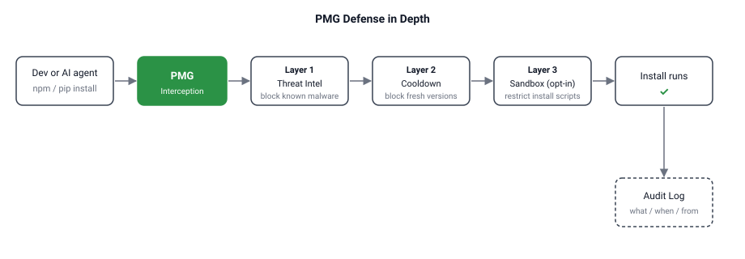

<div align="center">
    <h1>Package Manager Guard (PMG)</h1>
</div>

<p align="center">
    <strong>Block malicious packages before they install.</strong>
</p>

<p align="center">
<a href="https://trendshift.io/repositories/18640?utm_source=repository-badge&amp;utm_medium=badge&amp;utm_campaign=badge-repository-18640" target="_blank" rel="noopener noreferrer"></a>
</p>

<div align="center">
  
</div>

<br>

<div align="center">

[](https://docs.safedep.io/pmg/quickstart)
[](https://safedep.io)
[](https://discord.gg/kAGEj25dCn)
[](https://tldrsec.com/p/tldr-sec-316)

[](https://goreportcard.com/report/github.com/safedep/pmg)


[](https://api.securityscorecards.dev/projects/github.com/safedep/pmg)
[](https://github.com/safedep/pmg/actions/workflows/codeql.yml)

</div>

## Why PMG?

Developers and AI coding agents install packages every day. Each `npm install` or `pip install` executes thousands of lines of code that nobody reviews.

Recent compromises in popular ecosystems:

- [**Mini Shai-Hulud**](https://safedep.io/mini-shai-hulud-strikes-again-314-npm-packages-compromised/) - 300+ popular packages compromised
- [**litellm 1.82.8**](https://safedep.io/malicious-litellm-1-82-8-analysis/) - a popular AI proxy library compromised to exfiltrate credentials
- [**telnyx 4.87.2**](https://safedep.io/malicious-telnyx-pypi-compromise/) - a legitimate telecom SDK hijacked on PyPI
- [**pino-sdk-v2**](https://safedep.io/malicious-npm-package-pino-sdk-v2-env-exfiltration/) - a typosquat package disguised as the popular pino logger

**PMG is free, open source (Apache 2.0), and requires no account or API key.** It intercepts every package install and checks it against [SafeDep's free community API](https://safedep.io) for known malware **before** code executes. For **unknown malware**, it uses dependency cooldown and opt-in sandbox for proactive security defense.

## How PMG Works

PMG takes a defense in depth approach. Zero config, works across Zsh, Bash, Fish, and PowerShell on Windows. Each intercepted install passes through the protection layers that apply to it before code runs, along with an audit trail.

<div align="center">
  <picture>
    <source media="(prefers-color-scheme: dark)" srcset="./docs/assets/how-pmg-works-dark.svg">
    
  </picture>
</div>

<details>
<summary><strong>Layer details</strong></summary>

- **Transparent Interception** - PMG wraps `npm`, `pip`, and other package managers. Developers and AI agents use the same commands. No workflow changes.
- **Layer 1: Threat Intelligence** - PMG checks every package against [SafeDep's real-time threat intelligence](https://safedep.io) before install. Known malicious packages are blocked. No key, no login required.
- **Layer 2: Policy (Dependency Cooldown)** - PMG blocks package versions published inside a configurable cooldown window, so recently compromised versions are skipped during the window.
- **Layer 3: Opt-in Sandbox** - When sandbox is enabled and configured, PMG runs installs inside OS-native sandboxes (macOS Seatbelt, Linux Landlock by default, or Bubblewrap fallback) so install scripts have restricted system access even if a threat slips past the first two layers.
- **Audit Logging** - PMG logs every install (what, when, from where) for a verifiable audit trail.

</details>

## How PMG Compares

PMG combines install-time malware blocking, dependency cooldown, and an OS-native sandbox in one free, open-source tool, for developers and AI coding agents alike.

| Capability                              | PMG | Socket | safe-chain | Snyk | Dependabot |
| --------------------------------------- | --- | ------ | ---------- | ---- | ---------- |
| OSS / built in public                   | ✓   | ✗      | ✓          | ✗    | ✗          |
| No account or API key                   | ✓   | ✓      | ✓          | ✗    | ✗          |
| Install-time malicious package blocking | ✓   | ✓      | ✓          | ✗    | ✗          |
| Dependency cooldown policy              | ✓   | ✗      | ✓          | ✗    | ✗          |
| Runtime sandboxing                      | ✓   | ✗      | ✗          | ✗    | ✗          |
| Protects AI coding agents transparently | ✓   | ✗      | ✗          | ✗    | ✗          |
| Local audit logs                        | ✓   | ✗      | ✗          | ✗    | ✗          |
| Known-CVE remediation PRs               | ✗   | ✗      | ✗          | ✓    | ✓          |

> **Note:** This comparison is accurate as of October 2026.

## Quick Start

### 1. Install

```bash
curl -fsSL https://raw.githubusercontent.com/safedep/pmg/main/install.sh | sh
```

> See [Installation](#installation) for Homebrew, npm, and other install methods.

### 2. Setup

Wire PMG into your shell so it intercepts package managers.

```bash
pmg setup install
# Restart your terminal to apply changes
```

> **Tip:** Re-run `pmg setup install` after upgrading PMG to pick up new configuration options.
>
> All-users / golden images: `sudo pmg setup install --system` on Linux, or `pmg setup install --system` as administrator on Windows — see [docs/system-install.md](./docs/system-install.md).

Validate your installation and verify protection is working:

```bash
pmg setup doctor
```

> **Optional:** PMG inspects HTTPS traffic with an on-the-fly CA that it injects into package
> managers per run. To persist a single CA across runs and trust it in your OS trust store
> (needed for tools that ignore CA environment variables, such as Go on macOS and Windows),
> install it once:
>
> ```bash
> pmg setup cert install          # user scope, no sudo
> pmg setup cert status           # check trust state and expiry
> ```
>
> See [Certificate Authority](docs/cert.md) for scopes, rotation, and removal.

### 3. Use

See PMG blocking threats.

```bash
npm install --no-cache --prefer-online safedep-test-pkg@0.1.3
# or
pip install --no-cache-dir safedep-test-pkg==0.0.4
```

> **Note:** `safedep-test-pkg` (on npm and PyPI) is a benign test package flagged as malicious in SafeDep's database for
> testing and verification purposes.

Continue using your package managers as usual, or let your AI coding agent run them. PMG sits in the path, blocking malicious packages.

```bash
npm install express
# or
pip install requests
```

## Supported Package Managers

PMG supports the tools you already use:

| Ecosystem   | Tools    | Command Example     |
| ----------- | -------- | ------------------- |
| **Node.js** | `npm`    | `npm install <pkg>` |
|             | `pnpm`   | `pnpm add <pkg>`    |
|             | `yarn`   | `yarn add <pkg>`    |
|             | `bun`    | `bun add <pkg>`     |
|             | `aube`   | `aube add <pkg>`    |
|             | `npx`    | `npx <pkg>`         |
|             | `pnpx`   | `pnpx <pkg>`        |
|             | `aubx`   | `aubx <pkg>`        |
|             | `aubr`   | `aubr <script>`     |
| **Python**  | `pip`    | `pip install <pkg>` |
|             | `pipx`   | `pipx run <pkg>`    |
|             | `poetry` | `poetry add <pkg>`  |
|             | `uv`     | `uv add <pkg>`      |
|             | `uvx`    | `uvx <pkg>`         |

### Experimental

Support for these ecosystems is experimental. Behavior and output can change between releases.
`pmg setup install` does not wrap these tools. Run them through `pmg`.

| Ecosystem         | Tools   | Command Example         |
| ----------------- | ------- | ----------------------- |
| **Go**            | `go`    | `pmg go get <module>`   |
| **Rust (crates)** | `cargo` | `pmg cargo add <crate>` |

> **Note:** On macOS and Windows, `pmg go` needs the PMG CA in the OS trust store. Run
> `pmg setup cert install` first. See [Certificate Authority](docs/cert.md).

## Installation

<details>
<summary><strong>Install Script (macOS/Linux)</strong></summary>

Downloads the latest release from GitHub, verifies its SHA-256 checksum, and installs to `$HOME/.local/bin` (if on `PATH`) or `/usr/local/bin`.

```bash
curl -fsSL https://raw.githubusercontent.com/safedep/pmg/main/install.sh | sh
```

</details>

<details>
<summary><strong>Homebrew (macOS/Linux)</strong></summary>

```bash
brew tap safedep/tap
brew install safedep/tap/pmg
```

</details>

<details>
<summary><strong>mise (Cross-Platform)</strong></summary>

The [mise GitHub backend](https://mise.jdx.dev/dev-tools/backends/github.html) installs the latest release binary and verifies its checksum and GitHub attestation.

```bash
mise use -g github:safedep/pmg
```

</details>

<details>
<summary><strong>MSI or Chocolatey (Windows)</strong></summary>

Every release ships `pmg_Windows_x86_64.msi`. The MSI installs `pmg.exe` for all users and runs `pmg setup install --system`. Run it from an elevated prompt:

```powershell
msiexec /i pmg_Windows_x86_64.msi /qn
```

The [Chocolatey package](https://community.chocolatey.org/packages/pmg) installs the same MSI:

```powershell
choco install pmg
```

See [docs/system-install.md](./docs/system-install.md) for MDM rollout and upgrades.

</details>

<details>
<summary><strong>npm (Cross-Platform)</strong></summary>

```bash
npm install -g @safedep/pmg
```

> **Note:** npm-based installs can be fragile when Node.js is managed by version managers like [`mise`](https://mise.jdx.dev/) or [`asdf`](https://asdf-vm.com/). The global `npm` bin path changes with the active Node version, so switching versions can leave `pmg` unavailable on `PATH` (or pointing to an old install). For these setups, prefer the install script, Homebrew, or mise.

</details>

<details>
<summary><strong>Go (Build from Source)</strong></summary>

Requires the Go version that [`go.mod`](go.mod) specifies.

To install the latest release without a local repository clone:

```bash
# Ensure $(go env GOPATH)/bin is in your $PATH
# The Linux sandbox hangs in a cgo build. Release binaries set CGO_ENABLED=0.
CGO_ENABLED=0 go install github.com/safedep/pmg@latest
```

To build from a local repository clone, follow the [developer setup instructions](CONTRIBUTING.md#developer-setup).

</details>

<details>
<summary><strong>Binary Download</strong></summary>

Download the latest binary for your platform from the [Releases Page](https://github.com/safedep/pmg/releases).

</details>

<details>
<summary><strong>Container Image (GHCR)</strong></summary>

Prebuilt multi-arch (`linux/amd64`, `linux/arm64`) images are published to [GitHub Container Registry](https://github.com/safedep/pmg/pkgs/container/pmg) on every release. The image entrypoint is `pmg`.

```bash
# Pull the latest image (or pin a release tag, such as :v0.30.0)
docker pull ghcr.io/safedep/pmg:latest

# Run any pmg command
docker run --rm ghcr.io/safedep/pmg:latest version
```

</details>

## GitHub Actions

Protect CI workflows with one step. PMG analyzes every `npm install`,
`pip install`, etc. in the job.

```yaml
- uses: actions/checkout@v4
- uses: safedep/pmg@v0.34.0

# goes through the PMG proxy
- run: npm ci
```

Set `timeout-minutes` on the job. A hung proxy blocks the job until the
timeout, and the GitHub default is 360 minutes.

The action runs the PMG proxy for the job, with kernel enforcement where the
runner allows it. At the end of the job, the action stops PMG, fails the job
on a block, and writes a job summary. The summary proposes a network profile from the
destinations the job reached.

By default you get malware blocking and dependency cooldown. Sandbox isolation
is opt-in via the `sandbox` input. `sandbox: true` uses the shims instead of
the proxy daemon, so it turns off kernel enforcement. Tune behavior via inputs (`paranoid`,
`sandbox`, `cooldown-days`, ...) or point
`config-file` at a YAML in the repo. See
[docs/github-action.md](docs/github-action.md) for the full reference.

### Kernel Enforcement (Linux)

A step can ignore `HTTP_PROXY`. With kernel enforcement, PMG attaches eBPF
programs that make the Linux kernel route every eligible process through the
proxy. A step cannot bypass it with `env -i`, `sudo`, or an HTTP client of
its own. Enforcement needs passwordless `sudo` on the runner host, which
GitHub-hosted Ubuntu runners have. The `enforce` input is `auto` by default.
The action enforces on a GitHub-hosted runner, and runs the proxy without
enforcement on a self-hosted runner, in a job container, or without `sudo`.
Set `enforce: true` to fail the job where the runner cannot enforce.

```yaml
- uses: safedep/pmg@v0.34.0
  with:
    enforce: true

- run: npm ci
```

See [Kernel enforcement](docs/github-action.md#kernel-enforcement) for
container traffic and runner requirements. In a job with a job container, set
`expose-to-job-network: true` so Docker actions in the job can reach the
proxy. See
[Job containers and Docker actions](docs/github-action.md#job-containers-and-docker-actions).

## Uninstallation

If you installed the PMG CA with `pmg setup cert install`, remove it from the OS trust store
first. `pmg setup remove` does not remove it. Add `--system` if you installed it for all users.

```bash
pmg setup cert uninstall --purge   # --purge also deletes the CA keypair on disk
```

Remove shell integration:

```bash
pmg setup remove
```

To also remove the PMG configuration file:

```bash
pmg setup remove --config-file
```

Then uninstall PMG itself:

```bash
# Homebrew
brew uninstall safedep/tap/pmg

# npm
npm uninstall -g @safedep/pmg

# mise
mise unuse -g github:safedep/pmg

# Chocolatey (Windows)
choco uninstall pmg
```

On Windows, remove an MSI install from Apps & Features.

If you used the install script, delete the binary from the directory it installed to
(`$HOME/.local/bin` or `/usr/local/bin`). For a binary download, delete the binary from
where you put it.

```bash
rm "$(command -v pmg)"
```

## Trust and Security

PMG builds are reproducible and signed.

- **Attestations**: GitHub and npm attestations guarantee artifact integrity.
- **Verification**: You can cryptographically prove the binary matches the source code.
- See [Trusting PMG](docs/trust.md) for verification steps.

## User Guide

- [Configuration](docs/config.md)
- [Trusted Packages Configuration](docs/trusted-packages.md)
- [Dependency Cooldown](docs/dependency-cooldown.md)
- [Caching](docs/caching.md)
- [Analysis Cache](docs/analysis-cache.md)
- [Proxy Mode Architecture](docs/proxy-mode.md)
- [Persistent Proxy Server](docs/persistent-proxy.md)
- [Kernel Enforcement (Linux)](docs/persistent-proxy.md#kernel-enforcement-linux)
- [Certificate Authority](docs/cert.md)
- [System Install](docs/system-install.md)
- [Windows Support](docs/windows-support.md)
- [GitHub Action](docs/github-action.md)
- [Sandbox install for package managers](docs/sandbox.md)
- [Sandbox Presets](docs/sandbox-presets.md)
- [Sandbox exec for coding agents](docs/sandbox-exec.md)

## Support

If PMG saved you from a bad package, [star this repo](https://github.com/safedep/pmg). It helps others find it.

## Contributing

Contributions welcome. See [CONTRIBUTING.md](CONTRIBUTING.md) for build and test instructions.

Thank you to all contributors ❤️

<a href="https://github.com/safedep/pmg/graphs/contributors">
  
</a>

## Telemetry

PMG collects anonymous usage data. To disable, either:

- Set `disable_telemetry: true` in your PMG config file, or
- Export `PMG_DISABLE_TELEMETRY=true`.
