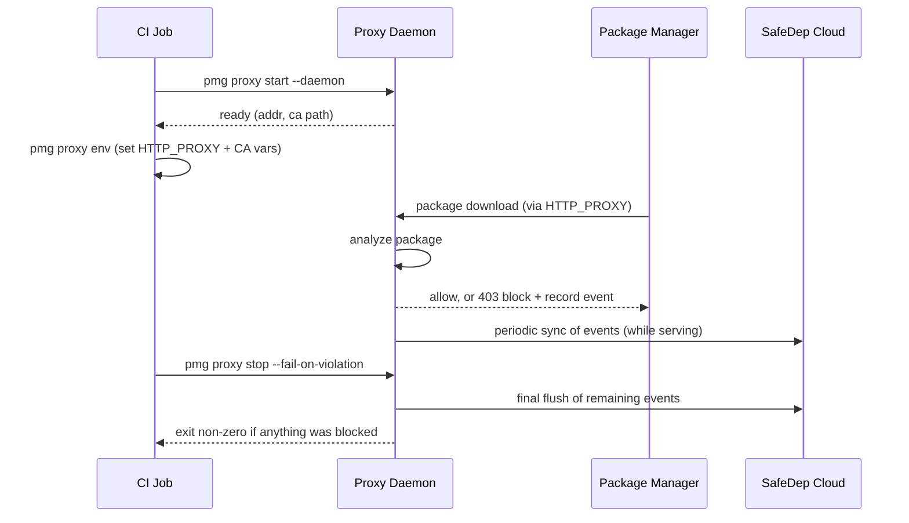

# Persistent Proxy Server

The persistent proxy server runs the PMG proxy as one long-lived process.
Every supported package manager in the environment goes through it, with no
shim, alias or `pmg` wrapper. It is made for CI jobs, where you set up the
environment once and then run many commands.

It uses the same interceptors, malware analyzer and certificate manager as
the proxy in [proxy.md](./proxy.md). The difference is the lifecycle. You
start the proxy once, the other `pmg proxy` commands find it, and it serves
every package manager until you stop it.

## Default proxy mode vs. persistent proxy server

`pmg npm install` starts a proxy, runs `npm` as a child with the proxy
variables set, and stops the proxy. The persistent server separates these
steps.

| | Default proxy mode | Persistent proxy server |
| --- | --- | --- |
| Command | `pmg npm install` | `npm install` |
| Proxy lifetime | One command | Until `pmg proxy stop` |
| Who runs the package manager | PMG | You, or the CI job |
| Ecosystems | The one you run | All supported |
| Suspicious package | Interactive prompt on a TTY. Verified malware blocks without a prompt. | Block, no prompt |
| Report | When the command exits | At `pmg proxy stop` |
| Made for | Local development | CI jobs |

## How it works



The `pmg proxy` commands run in separate workflow steps. They find each
other through a state file that the daemon writes.

## Usage

Use the persistent server in CI. For local development use `pmg npm
install`, which keeps the interactive prompt. The server blocks without a
prompt.

GitHub Actions with raw commands:

```yaml
- run: pmg proxy start --daemon
- run: pmg proxy env >> "$GITHUB_ENV"
- run: npm ci
- run: pmg proxy stop --fail-on-violation
  if: always()
```

Raw commands leave proxy variables in `GITHUB_ENV` after stop.
Later post actions can then send requests to a stopped proxy.
Clear the exported proxy variables yourself, or use the action's automatic post cleanup.
See its [manual stop example](github-action.md#server-mode).

GitHub Actions with the [safedep/pmg action](../action.yml), described in
[github-action.md](./github-action.md):

```yaml
- uses: safedep/pmg@v0.34.0
  with:
    api-key: ${{ secrets.SAFEDEP_API_KEY }}
    tenant-id: ${{ secrets.SAFEDEP_TENANT_ID }}

- run: npm ci          # intercepted automatically
```

By default the action starts the daemon and sets the variables for the
job. With the default `enforce: auto` it starts the daemon with
[kernel enforcement](#kernel-enforcement-linux) on a GitHub-hosted runner,
when the job runs on the runner host. github-action.md lists the
[conditions](./github-action.md#kernel-enforcement). Its post step stops the
proxy at the end of the job, flushes events to SafeDep Cloud when cloud sync
is on, fails the job when a package was blocked or a connection was denied,
and writes a job summary.

## Commands

```bash
pmg proxy start    # start the proxy, in the foreground or detached with --daemon
pmg proxy stop     # stop the proxy and report the outcome
pmg proxy env      # print the variables that route package managers through it
pmg proxy status   # report whether a proxy runs, and which network policy it applies
```

`pmg proxy <command> --help` lists the flags. `--daemon` works on Unix only.
On Windows use the foreground `pmg proxy start` and stop it with Ctrl+C in that terminal.
The current Windows liveness probe does not support `proxy stop`, reliable `proxy status`, or the stop/report gate.
It can treat a live process as stale and remove its state.
Do not use `--if-running` as a workaround.

For concurrent non-enforcing proxies, use separate `--state` paths.
Give each an isolated `PMG_CONFIG_DIR`, or use one persisted CA so they share a signing identity.
Otherwise one daemon's `proxy-ca.pem` can overwrite another daemon's ephemeral bundle and break TLS.
Ports are random by default.
Use separate `--port` values only if your config fixes the listen port.

`pmg proxy stop --if-running` exits 0 when the state file is absent.
A stale state file left by a crashed daemon still fails.
`--report <file>` writes JSON even on a violation.
With no state and `--if-running`, it writes a zero-valued report before the violation gate.
Typical fields follow.
Optional fields can be absent.

```json
{"stopped":true,"pid":1234,"blocked_count":0,"state_verified":true,"run_id":"example","observed":2}
```

The report can also contain `network`, `cloud_sync`, and `violation`.
`proxy status` normally exits 0 for running, stopped, or unreadable state.
Parse its result deliberately instead of treating its exit code as a liveness test.

Default state and detached output paths are `<cache-dir>/proxy-state.json` and `<cache-dir>/proxy.log`.
`--state` and start's `--log-file` override these paths.
Use the same state path and effective user for env, status, and stop.
Root uses root's cache unless `PMG_CACHE_DIR` changes it.
For foreground diagnostics, run `pmg --debug proxy start`.
For a separate daemon diagnostic sink, use `pmg --debug --log /absolute/path/pmg-debug.log proxy start --daemon`.
`--debug` alone is not forwarded as a flag to the detached child.
Its default `proxy.log` need not contain per-request diagnostics.
Audit events provide package-level block evidence in the effective user's [event log](proxy-mode.md#troubleshooting).

The daemon reads all configuration at process start.
It applies shared [trust](trusted-packages.md), paranoid, and [cooldown](dependency-cooldown.md) controls.
It has no per-command withheld-version hint or command-line pin map.
Some npm and PyPI resolver failures leave older eligible versions and do not increase its blocked count.
Restart after any configuration change.

## Bind address

The proxy binds `127.0.0.1` on a random port. Only the host reaches it,
which is right for CI and local use. `--host` and `--port` change this, and
so do `proxy.server.listen_host` and `listen_port` in the config. A flag has
priority over the config.

Bind another address, such as `0.0.0.0`, only for a deployment you host on
purpose. It exposes the proxy to the network, and every client you route
through it must trust the PMG CA.

With a wildcard bind such as `0.0.0.0`, `pmg proxy env` exports
`127.0.0.1` on the same port, because a client cannot connect to a wildcard
address. A client on another machine must use the address of this machine.

## Go modules

The daemon analyzes Go module downloads from `proxy.golang.org` and from the
Go proxies in `proxy.registries`. It runs malware analysis and the dependency
cooldown on the module zip. It never decrypts `sum.golang.org`, so go
verifies the checksum database itself.

A block is a 403 response. After a comma in `GOPROXY`, go tries the next
entry only after a 404 or 410 response, so the block is final. The daemon
does not change `GOPROXY`, and it does not analyze these fetches:

- A module that matches `GOPRIVATE` or `GONOPROXY`. go fetches it from its
  VCS host.
- Every module when `GOPROXY` is `direct` or `off`.
- A module after a `|` separator in `GOPROXY`. go tries the next entry after
  any error, also after a block.
- A module that the module proxy does not have. With the default
  `GOPROXY=https://proxy.golang.org,direct`, go fetches it from its VCS host.
- A corporate `GOPROXY` endpoint absent from `proxy.registries`.
  The daemon does not import the client's `GOPROXY` as `pmg go` does.
  Add that proxy to `proxy.registries`.
- A Go toolchain download for `golang.org/toolchain`.
  Go verifies it through the checksum database.
- A module that is already in the module cache, for example a cache that the
  CI job restores.

On macOS and Windows, the OS trust store must trust the PMG CA. See
[Go on macOS and Windows](./cert.md#go-on-macos-and-windows). If it does not,
or the CA is expired, the daemon does not decrypt Go traffic. `pmg proxy
start` and `pmg proxy status` then print a notice with the cause. Run
`pmg setup cert install`, then restart the daemon.

## Cargo crates

The daemon analyzes crates from crates.io and from the Cargo registries in
`proxy.registries`. It removes versions in the cooldown window from sparse
index responses. It runs malware analysis and the dependency cooldown on
each `.crate` download. It never decrypts the crates.io API host, so the
token of `cargo publish` stays in the tunnel.

The daemon does not analyze these fetches:

- A git dependency. cargo fetches it from its VCS host.
- A download endpoint that is not configured. A git index itself is not parsed, but a configured `.crate` download can still be analyzed.
- A crate that is already in the cargo cache in `$CARGO_HOME/registry`, for
  example a cache that the CI job restores.

A Cargo `http.proxy` in `.cargo/config.toml`, `CARGO_HTTP_PROXY`, or git config takes priority over `HTTPS_PROXY`.
It can bypass this daemon.
Under kernel enforcement, this remains possible when that upstream proxy uses an unrouted port.

cargo reads `CARGO_HTTP_CAINFO`, which `pmg proxy env` prints. Under
enforcement cargo trusts the system trust store.

## Custom registries

The daemon reads `proxy.registries` once, at start, from the same config
file the default proxy mode reads. See
[Custom Registries](./proxy-mode.md#custom-registries).

The daemon does not see a later edit. Restart it after you change a
registry.
Before restarting, restore the original upstream proxy settings in the shell that starts the daemon.
A shell that evaluated `pmg proxy env` still points at the old PMG listener.
A new daemon inherits those variables and can try to use the stopped proxy as its upstream.
Preserve and restore a required corporate proxy instead of simply unsetting it.

```bash
pmg proxy stop
# Restore the original HTTP_PROXY, HTTPS_PROXY, NO_PROXY, and lowercase equivalents here.
pmg proxy start --daemon
eval "$(pmg proxy env --export)"
```

PMG supports HTTP, HTTPS, and SOCKS upstream proxies.
Loopback destinations bypass that upstream.

`pmg npm install` starts a new proxy for each command, so it always reads
the current file.

## Certificate trust

The proxy terminates TLS, so a client must trust its CA. `pmg proxy env`
prints the variables that point each tool at the CA bundle:
`NODE_EXTRA_CA_CERTS`, `SSL_CERT_FILE`, `REQUESTS_CA_BUNDLE`, `PIP_CERT`,
`YARN_HTTPS_CA_FILE_PATH` and `CARGO_HTTP_CAINFO`. You do not install the CA into the OS trust
store, except for Go on macOS and Windows. See
[Go on macOS and Windows](./cert.md#go-on-macos-and-windows).
`NO_PROXY` always excludes `localhost`, `127.0.0.1` and `::1`.

The variables exist because tools do not agree on the OS store. Node ignores
it by default, modern pip reads it, and `requests` ships its own bundle. The
variables work for all of them.

Except for Go on macOS and Windows, you do not run `pmg setup cert
install`. The proxy reuses a persisted user CA when available.
Otherwise it generates an ephemeral signing CA.
On macOS, run `pmg setup cert install --system` as your normal user and approve the elevation prompt.
On Windows, run it from a terminal started as administrator.
The keypair stays in the running account's config directory.
If Windows elevation uses a different administrator account, that account owns the keypair.
A non-enforcing proxy under the keypair's account reuses it.
On Linux, `sudo pmg setup cert install --system` instead writes a root-owned keypair to `/etc/safedep/pmg` for kernel enforcement.
An unprivileged proxy does not read that root keypair.
See [certificate scopes](cert.md#trust-scopes).

Non-enforcing `pmg proxy env` also changes client behavior.
It sets pip retries to 0, overrides npm and Yarn proxy settings, and restricts proxy bypass to loopback.
It forces Cargo's sparse crates.io protocol and sets `CARGO_HTTP_CHECK_REVOKE=false`.
On Windows, the latter disables Cargo revocation checks for all HTTPS hosts, including tunneled hosts.
It adds `x509sslcertoverrideplatform=0` to `GODEBUG` for Go trust selection unless the user already set that key.
It preserves unrelated `GODEBUG` settings.
These side effects do not apply to the enforcing export, which uses the [system-trust variables](#trust).

## Cloud event sync

The daemon delivers events only when both `cloud.enabled` and `cloud.auto_sync.enabled` are true.
Auto-sync defaults to true.
With auto-sync off, events remain local and stop prints no sync line.
Configure credentials through the keychain or `SAFEDEP_API_KEY` and `SAFEDEP_TENANT_ID`.
A root daemon uses root's credential context.
Pass the required variables through sudo or provision credentials for that account.
No API-key YAML field substitutes for these credentials.
On an ephemeral runner, arrange delivery before the runner is destroyed. The daemon records each blocked
package in a local event log at once, syncs pending events while it serves,
and flushes the rest on shutdown.

`pmg proxy stop` reports the result, `Synced N event(s) to SafeDep Cloud` or
a `Cloud sync failed` line. A failed flush does not change the
`--fail-on-violation` exit code.
Stop can wait about 205 seconds for request drain and cloud shutdown work.

## Network policy

The daemon applies the network rules of a sandbox profile, the same
`network` block the one-shot proxy applies under a sandbox. See
[Network rules](./sandbox.md#network-rules) for the rule syntax. The daemon
reads only the `network` block. It warns at start when the profile has
filesystem, process or environment rules, because only a sandbox applies
those. Without a profile the daemon has no policy and says so at start.
A profile with only a `network` block must set `package_managers` or inherit
them from its parent chain, or it fails to load.

```yaml
proxy:
  server:
    profile: profiles/ci.yml   # built-in name, policy_templates name, user profile name, or path
    network_mode: audit        # audit | enforce
```

| Config key | Flag | Variable |
| --- | --- | --- |
| `profile` | `--profile` | `PMG_PROXY_SERVER_PROFILE` |
| `network_mode` | `--network-mode` | `PMG_PROXY_SERVER_NETWORK_MODE` |
| none | `--network-allow` (repeatable) | none |
| none | `--network-deny` (repeatable) | none |

A relative `profile` path in the config resolves next to the config file
first. A relative `--profile` path resolves against the working directory.
A reference with a directory part or a `.yml` or `.yaml` extension is a path.
A bare name resolves as a built-in, policy template, or user profile first.
A working-directory file cannot replace a name already found there.
An unresolved bare name can still fall back to a file in the working directory. Under `global_lockdown` the managed config names a built-in
profile, one of its `policy_templates`, an absolute path, or a path relative
to the managed config file. A parent in its chain resolves the same way. A
user profile, a user preset and the working directory are writable by the
user, so they are not read. The two rule flags add one `host:port` rule each to the resolved
profile. `--network-allow` also removes an equal deny rule, because deny wins
at equal specificity. A child inherits its parent's allow and deny lists and cannot remove an entry.
It can still widen the result with a more specific allow or `deny_ip_literals: false`.
Under lockdown, the daemon refuses a replacement profile that widens the managed one.

```bash
pmg proxy start --daemon --profile .pmg/profiles/ci.yml --network-mode enforce \
  --network-deny pastebin.com:443
```

A profile with `deny_ip_literals: true` denies an IP literal, an address
and not a name, unless an allow rule names that exact address. The report
names the rule `ip_literal`.
Loopback addresses follow the ordinary rules.
The proxy always drops redirected TLS without a usable server name.
With `deny_ip_literals: true`, it also records that connection against the original destination IP.
An exact IP allow does not make the TLS handshake possible. See
[Network rules](./sandbox.md#network-rules).

Under `audit`, the default, the proxy records a match on a deny rule and lets
the connection through. Under `enforce` the proxy refuses it: a proxy-aware
client gets a 403 that names the destination and the rule, and a redirected
TLS connection is closed before the handshake. Every match writes a
`network_policy` event. A redirected container connection is decided by host
and port, as a host connection is.

Under [kernel enforcement](#kernel-enforcement-linux), the policy applies to routed TCP traffic on the enforced ports from eligible processes.
Other ports, host skip destinations, exempt processes, and containers without namespace redirection can bypass it.
See [Eligibility](#eligibility).
An added port must carry supported client-first HTTP or TLS.
The transparent listener allows a silent client 10 seconds to send its first bytes.
Without enforcement, clients can ignore the proxy variables. The
start line and `pmg proxy status` say which: `Network policy: enforce,
profile npm-restrictive < /work/app/.pmg/profiles/ci.yml, enforce: off, policy
advisory`. The profile is the inheritance chain, base first.

`pmg proxy stop` reports the matches:

```text
Network policy: enforce, 4 denied, 0 would deny
  denied  193.32.204.199:80  rule *:*  /usr/bin/curl pid 4132
  denied  pastebin.com:443   rule *:*  172.17.0.2 (3)
Profile: pypi-restrictive < /etc/pmg/profiles/runner.yml  ports 80,443
```

The columns are the action, the destination, the rule, and the program with
its pid, or the container address. Under `audit` the action reads `would
deny`. With kernel enforcement the kernel names the program. Without it a
proxy-aware client has no name. `ports` are the enforced ports.

Under `global_lockdown` a profile and a flag may narrow the policy and may
not widen it. `--network-deny` and `enforce` over `audit` narrow.
`--network-allow`, and `--network-mode audit` over a file that says
`enforce`, fail fast. A `--profile` that adds an allow rule, or drops a deny
rule, of the managed profile fails the start and names the rule.
An empty override cannot remove a managed profile.
A replacement must retain a managed `deny_ip_literals: true`.

A repository profile is as trusted as the workflow file. Add a `CODEOWNERS`
line for `.pmg/profiles` so a change to it gets a review.

### Build the allow list

The proxy records every destination it handles.
It has no observation of traffic that bypasses it. A run under
`audit` with no profile gives the baseline for the allow list. Three runs
take a daemon from no policy to `enforce`.

1. **Observe.** Start the daemon with no profile, run the commands through
   it, stop the daemon. `pmg proxy env` exports the run id as
   `PMG_PROXY_RUN` for a script. The stop report counts the destinations
   and names the run:

   ```text
   Destinations: 7 observed. Propose a profile with: pmg sandbox profile propose --run 3f2a9c1d7e4b
   ```

2. **Propose.** The command reads the run from the event log. It prints
   each destination with its client, its count and the proposed action.
   `--new` writes the profile. `--dry-run` shows the file and does not
   write it.

   ```bash
   pmg sandbox profile propose --run 3f2a9c1d7e4b --new .pmg/profiles/ci.yml
   ```

   Use the root user's event-log context after a root daemon run.
   Run the proposal with sudo and preserve the daemon's config directory when it used one.
   Start the daemon in the checkout so its recorded repository matches later `--last` or `--since` selection.
   An explicit run ID avoids that selection ambiguity.

   The profile inherits `exec` and holds one allow rule per host and port.
   It sets `deny_ip_literals: true` unless the target already sets that key.
   It adds a catch-all deny only when its parent has none.
   The warning about unused filesystem, process, and environment rules is expected for `exec` inheritance. On a GitHub Actions runner it inherits
   `github-actions`, which allows the hosts of the runner. A proposal from a one-shot run inherits the
   built-in profile of the package manager and does not repeat the registry
   hosts that profile already allows. Review every rule. Commit the file.

3. **Enforce.** Start the daemon with `--profile .pmg/profiles/ci.yml
   --network-mode enforce`.
   The proxy refuses a destination that no allow rule of the profile or parent covers.
   Response behavior follows [Network policy](#network-policy).

A later run adds destinations with `--into .pmg/profiles/ci.yml`. A
proposal adds allow rules and does not remove rules, because one run does
not reach every destination.
A specific deny rule keeps a destination denied.
A catch-all or IP-literal denial alone can receive a proposed allow.
A destination refused under enforce mode gets no proposed rule.
Add such a rule by hand when needed. `--last` uses the newest run of the repository.
`--since 30d` merges every run of the repository in the window. The event
log keeps `event_log_retention_days` of runs. With `skip_event_logging` on,
the command has no data.

## Fail on violation

`pmg proxy stop` exits `0` by default. `--fail-on-violation` makes it a gate:

- It exits non-zero when any package was blocked, or when the network
  policy refused a connection under `enforce`.
- It fails when the state is missing or unreadable after shutdown.
  A daemon that crashed before stop also makes stop fail.
  The current check only verifies that state is readable.
  It does not prove that the daemon wrote final counts.
  A daemon killed during shutdown before its final write can report the start-time count of 0.

The package manager's own non-zero exit, from the `403` on a blocked
download, is a separate signal. `--fail-on-violation` is the proxy's own
verdict, whatever the package manager reported.

## Kernel enforcement (Linux)

A variable is a request. A process can ignore it. Node needs
`NODE_USE_ENV_PROXY=1` to read `HTTP_PROXY`, `env -i` and `sudo` drop the
variables, and an install script with its own HTTP client never reads them.
`pmg proxy start --enforce` removes that gap on Linux. The kernel sends every
TCP connection to ports 80 and 443 from every eligible process to the proxy.
A process cannot opt out.

This section covers a Linux machine, such as a VM or a build host. For
GitHub Actions, see [github-action.md](./github-action.md#kernel-enforcement).

### Requirements

- Linux 5.15 or later with kernel BTF (`CONFIG_DEBUG_INFO_BTF`) and cgroup
  v2.
- `CAP_BPF`, `CAP_NET_ADMIN` and `CAP_PERFMON`, so root in practice. Run
  every `pmg proxy` command under `sudo`, so that it finds the state file of
  the root daemon.
- A root-owned CA keypair in `/etc/safedep/pmg` and its certificate in the system trust store. `sudo pmg setup cert install --system` supplies both.

`pmg setup doctor` reports whether the host can enforce. `pmg proxy start
--enforce` fails before it binds a port when a requirement is missing, and
the error names it. On macOS and Windows it fails with an error that names
the platform.

### Set it up

1. Install the PMG CA in the system trust store:

   ```bash
   sudo pmg setup cert install --system
   ```

   The command runs `update-ca-certificates`, or `update-ca-trust` on
   Fedora, RHEL and Arch. Then it checks that the system bundle has the CA.

2. Turn on enforcement in the managed config,
   `/etc/safedep/pmg/config.yml`:

   ```bash
   sudo pmg config set --system proxy.server.enforce.enabled true
   ```

   This creates a managed config if none exists.
   It governs every user on the machine and replaces per-user configuration.
   See [managed configuration](config.md#globally-managed-configuration).

3. Start the daemon:

   ```bash
   sudo pmg proxy start --daemon
   ```

4. Set the [trust variables](#trust) in your shell:

   ```bash
   eval "$(sudo pmg proxy env --export)"
   ```

5. Use your package managers as usual. A blocked package fails with a `403`.

6. To end enforcement, stop the daemon:

   ```bash
   sudo pmg proxy stop
   ```

`pmg proxy start --enforce` turns on enforcement without step 2. The daemon
then reads root's per-user config and warns. See
[Which config file the daemon reads](#which-config-file-the-daemon-reads).

`eval` sets the trust variables in the current shell only. To set them in
every login shell, write them to a profile script:

```bash
sudo pmg proxy env --export | grep -v PMG_PROXY_RUN | sudo tee /etc/profile.d/pmg-trust.sh
```

Do not overwrite `/etc/profile.d/pmg.sh`, which system setup owns for shim PATH integration.

### Run it as a service

To enforce from boot, run the daemon as a `systemd` service. See the
[example unit](../examples/systemd/pmg-proxy.service). `Restart=on-failure`
starts it again after a crash. The unit writes its state to
`/run/pmg/proxy-state.json`, so give that path to the other commands:

```bash
sudo pmg proxy status --state /run/pmg/proxy-state.json
```

The example's `Before=actions.runner.service` is not a real runner unit name.
Use a drop-in on the actual `actions.runner.<repo-or-org>.<runner>.service` with `After=pmg-proxy.service` and `Requires=pmg-proxy.service`.
`Type=simple` alone does not wait for enforcement readiness.
Add a bounded readiness check, such as the following service directive, for a fresh `/run/pmg` state directory.

```ini
ExecStartPost=/bin/sh -c 'i=0; until [ -s /run/pmg/proxy-state.json ]; do i=$((i+1)); [ "$i" -lt 150 ] || exit 1; sleep 0.2; done'
```

The daemon writes initial state after attach.
Check that the state belongs to this service instance if you retain it across starts.

### How it works

The daemon attaches BPF programs to the cgroup v2 root. The `connect` hooks
rewrite the destination of an eligible connection to the proxy's loopback
listener and record the original destination. The proxy looks at the first
bytes of each redirected connection. TLS to a registry host is terminated
with the PMG CA. Every other host is passed through with its real
certificate. Plain HTTP is served as a proxy request. With `deny_udp` on, UDP to an enforced port
gets `EPERM`, so a QUIC client falls back to TCP. The kernel also records
which process opened each connection, and the
[Host Observation event](./proxy-mode.md#how-pmg-matches-a-request) names it.

When the daemon exits, for any reason, the kernel detaches the programs.
The kernel also removes the owned nftables table after a crash.
The namespace listener address on `lo` and the state file can remain.
The next start reuses them. Until the daemon runs again,
connections go out directly. A supervisor that restarts it, such as
`Restart=on-failure` in the
[example unit](../examples/systemd/pmg-proxy.service), keeps that time
short.

One daemon enforces a cgroup. A second `pmg proxy start --enforce` on the
same cgroup fails with `EnforceAlreadyActive`. The daemon locks the cgroup
directory while it is attached, so two daemons that start at the same
moment cannot both pass the check. It attaches before it reports ready, so
every connection made after the start is enforced.

### Eligibility

Every process is eligible unless the policy says otherwise. Only the daemon's
own pid is exempt by pid. The `pmg` binary is not exempt, so
`PMG_INSECURE_INSTALLATION=true pmg npm install` cannot bypass the daemon.

A daemon started with `PMG_INSECURE_INSTALLATION=true` bypasses malware analysis unless lockdown clears it.
Cooldown and network policy can still block.
Check the daemon's start environment separately from later child commands.

The policy lives in `proxy.server.enforce`:

```yaml
proxy:
  server:
    listen_port: 7777
    enforce:
      enabled: true
      ports: [80, 443]
      eligible_users: []
      exempt_users: []
      exempt_executables:
        - /opt/observability/bin/agent
      skip_destinations: [10.20.0.0/16]
      cgroup: ""
      deny_udp: true
```

- `ports` are the destination ports to route. The ports of
  `proxy.registries` endpoints are always added.
- `exempt_executables` are absolute paths or absolute globs of programs that connect
  directly. The daemon also exempts a matching file that appears later, so
  a user who can write the folder can add one. Never exempt an interpreter
  such as `node`, `python3` or `sh`, or an HTTP client such as `curl` or
  `wget`. An install script can run any of them.
- `exempt_users` never routes those users. Both user lists accept a name or numeric UID.
- `eligible_users` limits enforcement to some users. It is safe only when no
  eligible user can become another one. `sudo curl` runs as root, and root is
  then not eligible. Leave it empty when an eligible user has `sudo`. The
  daemon warns when an eligible user is in the `sudo` or `wheel` group.
- `skip_destinations` takes CIDR prefixes such as `10.20.0.0/16` or `10.0.0.5/32`.
  It adds to the built-in host skip list for loopback, link-local metadata, and `168.63.129.16`.
- `cgroup` is an absolute cgroup v2 directory path, such as `/sys/fs/cgroup/system.slice`. It limits the scope to that directory. The default is the
  root, which covers every process on the host.

The cgroup, user, executable, and skip rules above apply to host sockets.
Namespace redirect ignores these filters and the built-in skip list.
It redirects container connections to enforced ports except for host and container destinations handled by Docker's routing exceptions.
This includes plain HTTP cloud metadata on port 80.
Forwarding that request from the host namespace can defeat an IMDSv2 hop limit of 1.
Do not rely on `skip_destinations` to exclude metadata or IP-only TLS in redirected containers.

### Which config file the daemon reads

A root daemon accepts `/etc/safedep/pmg/config.yml` only when root controls the file and its path.
Otherwise it reads `$PMG_CONFIG_DIR/config.yml` when set, or root's own user file.
Preserved environment variables can therefore point root at another directory.
Without `PMG_CONFIG_DIR`, it does not read the invoking user's file.
`pmg proxy status` and the daemon log name the loaded config.
Detached start output does not normally print that path.
A start using root's per-user file warns on the terminal.
Use `sudo pmg config edit --system` or `sudo pmg config set --system <key> <value>` to change managed configuration.
See [configuration paths](config.md#which-file-a-command-reads).

### Policy from the command line

Every policy key has a `PMG_*` variable.
All except `namespaces.ingress` and `namespaces.address` also have a start flag.

| Config key | Flag | Variable |
| --- | --- | --- |
| `enabled` | `--enforce` | `PMG_PROXY_SERVER_ENFORCE_ENABLED` |
| `ports` | `--enforce-port` (repeatable) | `PMG_PROXY_SERVER_ENFORCE_PORTS` |
| `eligible_users` | `--enforce-eligible-user` (repeatable) | `PMG_PROXY_SERVER_ENFORCE_ELIGIBLE_USERS` |
| `exempt_users` | `--enforce-exempt-user` (repeatable) | `PMG_PROXY_SERVER_ENFORCE_EXEMPT_USERS` |
| `exempt_executables` | `--enforce-exempt-executable` (repeatable) | `PMG_PROXY_SERVER_ENFORCE_EXEMPT_EXECUTABLES` |
| `skip_destinations` | `--enforce-skip-destination` (repeatable) | `PMG_PROXY_SERVER_ENFORCE_SKIP_DESTINATIONS` |
| `cgroup` | `--enforce-cgroup` | `PMG_PROXY_SERVER_ENFORCE_CGROUP` |
| `deny_udp` | `--enforce-deny-udp` | `PMG_PROXY_SERVER_ENFORCE_DENY_UDP` |
| `namespaces.mode` | `--enforce-namespaces` | `PMG_PROXY_SERVER_ENFORCE_NAMESPACES_MODE` |

A list flag adds to the list in the file. It never replaces it, so a flag
cannot drop a skip destination or an exempt user an administrator set. A
list variable, comma separated, replaces the list, as every `PMG_*` variable
does when lockdown is inactive.
Lockdown ignores configuration `PMG_*` variables. `--enforce-cgroup`, `--enforce-deny-udp` and `--enforce-namespaces`
override the file.

```bash
sudo pmg proxy start --daemon --enforce \
  --enforce-exempt-executable '/opt/agent/bin/agent' \
  --enforce-skip-destination 10.20.0.0/16
```

`pmg proxy start` checks the flags before it detaches, so it reports an
unknown user or a bad prefix at once. Under `global_lockdown` it refuses a
flag that loosens the policy: `--enforce-eligible-user`,
`--enforce-exempt-user`, `--enforce-exempt-executable`,
`--enforce-skip-destination`, `--enforce=false`, `--enforce-deny-udp=false`, and
`--enforce-namespaces` with a value other than `redirect`.
`--enforce-port` stays allowed and adds routed ports.
`--enforce-cgroup` also stays allowed in the current implementation.
It limits enforcement to that cgroup and leaves processes outside it direct.
Do not treat lockdown as preventing this scope change.

### Trust

The kernel cannot set a process's environment, so enforcement uses the
system trust store. `sudo pmg setup cert install --system` writes the
keypair to `/etc/safedep/pmg/`, root-owned with a `0600` key, and installs
the certificate into the store. `pmg proxy start --enforce` refuses to start
when the CA is not in the store, and it never makes a CA for one run.

Trust decides whether a tool works. It never lets a connection bypass the
proxy. A client that does not trust the CA fails the TLS handshake on a
registry host and gets nothing. Other hosts keep their real certificate, so
`github.com` and `apt` need no trust.

Under enforcement `pmg proxy env` prints no proxy variables. It prints the
variables that point a tool at the system store, and the path of the bundle:

| Variable | Why |
| --- | --- |
| `NODE_USE_SYSTEM_CA=1` | Node, npm, pnpm, and Yarn need it. Node 22.19+ in the 22 line and Node 24.6+ read it. Node 23 and Node 24.0–24.5 ignore it. |
| `UV_NATIVE_TLS=1` | uv validates against its bundled roots without it. |
| `REQUESTS_CA_BUNDLE=<system bundle>` | Tools built on Python `requests` validate against `certifi`. Poetry needs it. pip 24.2+ on Python 3.10+ can use system trust without it. |
| `PMG_CA_BUNDLE=<system bundle>` | The file to pass into a container. See below. |
| `PMG_PROXY_RUN=<id>` | The run in the event log, for `pmg sandbox profile propose --run`. |

`curl`, Go, Cargo, Bun, and aube trust the store on their own.
pip uses system roots by default only with pip 24.2+ on Python 3.10+.
Older pip combinations need the exported bundle.
PMG currently emits `UV_NATIVE_TLS`.
Recent uv versions deprecate that name in favor of `UV_SYSTEM_CERTS`.
For uv 0.11.0 or later, set `UV_SYSTEM_CERTS=1` when configuring trust manually.
See the [uv environment reference](https://docs.astral.sh/uv/reference/environment/#uv_system_certs).
The old variable can produce a deprecation warning.

Node before 22.19, Node 23, and Node 24 before 24.6 ignore `NODE_USE_SYSTEM_CA`.
For these versions, point
`NODE_EXTRA_CA_CERTS` at the bundle:

```bash
export NODE_EXTRA_CA_CERTS="$PMG_CA_BUNDLE"
```

### Containers and other network namespaces

A container has its own network namespace, so the `connect` hooks do not
see it. Its traffic enters the host through a bridge, and
`proxy.server.enforce.namespaces` redirects it there. Set one key:

```yaml
proxy:
  server:
    enforce:
      namespaces:
        mode: redirect   # ignore | redirect | auto
```

- `redirect` turns it on. The start fails when the host cannot redirect.
- `auto` turns it on where the host can and runs as `ignore` elsewhere, with
  the reason in `pmg proxy status`.
- `ignore` is the default.

The flag is `--enforce-namespaces <mode>`. The redirect covers `docker run`,
and `RUN` steps in `docker build` with the default builder and with a
`docker-container` builder. A `--network host` container is in the host
namespace and takes the `connect` path.

A container must trust the PMG CA to install through the proxy. See
[Trust inside a container](#trust-inside-a-container).

#### How the redirect works

The daemon adds `169.254.200.1` to `lo`, listens on it, and loads one
nftables table named `pmg`. A rule on every ingress interface, `docker0`
and `br-*` by default, sends TCP to the enforced ports to that listener. The
listener reads the original destination from conntrack. Three destinations
are never redirected: an address on the host, a container on the same
bridge, and a container on another bridge. Docker's own rules decide those.
A connection over IPv6 to an enforced port is refused, because the listener
has an IPv4 address, and the client falls back to IPv4. UDP to an enforced
port is refused too when `deny_udp` is on.

The table carries the owner flag, so the kernel deletes it when the daemon's
netlink socket closes, after a clean stop and after a crash. `pmg proxy
status` prints one line:

```
  namespaces: redirect (169.254.200.1:18443 from docker0, br-*)
```

Two more keys exist for a host that is not a Docker host. `ingress` lists
the interfaces, with a trailing `*` as a wildcard. `address` changes the
listener address. Both have the defaults above.

The redirect needs nf_tables, conntrack, and Linux 5.13+ for owned tables.
It runs only with enforcement, so the effective minimum is Linux 5.15.
See [Requirements](#requirements).

#### Host firewalls

A firewall with a default deny on input, such as ufw on iptables-nft, drops a
redirected connection on its way to the listener, and the container hangs.
The daemon detects nftables input chains with a drop policy.
It does not detect legacy iptables firewalls.
When it finds a drop-policy chain, it warns and names a rule to add. For ufw:

```sh
sudo ufw allow in on docker0 to 169.254.200.1
```

For a plain nftables firewall, add an `accept` for `iifname "docker0" ip
daddr 169.254.200.1` to the input chain. Docker's forward rules do not cover
this, because the connection now goes to the host.
Add an input rule for every ingress interface, including each `br-*` bridge used by a custom Docker network.

#### Trust inside a container

The redirect is transparent. Trust is not. The proxy terminates a connection
to a registry host with the PMG CA, and a client in a container that does
not trust the CA fails the handshake. The daemon log then names the fix.
Every other host keeps its real certificate.

Pass the file that `PMG_CA_BUNDLE` names into the container. It holds the
PMG CA and the public roots, so the other hosts keep working.
`NODE_EXTRA_CA_CERTS` adds to the container's own trust. A tool that
replaces its bundle (`SSL_CERT_FILE`, `REQUESTS_CA_BUNDLE`, `PIP_CERT`,
`CURL_CA_BUNDLE`) needs the full host bundle.

A `docker run` step:

```bash
docker run --rm -v "$PMG_CA_BUNDLE":/pmg-ca.pem:ro -v "$PWD":/app -w /app -e NODE_EXTRA_CA_CERTS=/pmg-ca.pem node:22 npm ci
```

A build takes the bundle as a secret, so it never enters the image.
`mode=0444` is needed when the build step runs as a non-root user.
The default secret mount is readable by root only.

```bash
docker build --secret id=pmg-ca,src=$PMG_CA_BUNDLE -t app .
```

```dockerfile
RUN --mount=type=secret,id=pmg-ca,target=/run/pmg-ca.pem,mode=0444 \
    NODE_EXTRA_CA_CERTS=/run/pmg-ca.pem npm ci
```

### Test it before you deploy

Run these on a Linux machine with Docker. If a daemon runs, stop it first.
Start the daemon with the container redirect, and set the trust variables:

```sh
sudo pmg setup cert install --system
sudo pmg proxy start --daemon --enforce --enforce-namespaces redirect
sudo pmg proxy status   # namespaces: redirect (169.254.200.1:<port> from docker0, br-*)
eval "$(sudo pmg proxy env --export)"
```

If the start printed a firewall warning, add the rule it names first.

1. A host process is enforced. Without proxy variables, curl still reaches
   the registry through the proxy.

   ```sh
   env -i /usr/bin/curl -sSv -o /dev/null https://registry.npmjs.org/ 2>&1 | grep issuer
   # issuer: O=SafeDep PMG; CN=SafeDep PMG Proxy CA
   ```

2. A container that connects to a host that is not a registry passes
   through. It needs nothing.

   ```sh
   docker run --rm curlimages/curl -sS https://ifconfig.co
   ```

3. A container that connects to a registry without the PMG CA fails closed,
   and the daemon log names the fix.

   ```sh
   docker run --rm curlimages/curl -sS https://registry.npmjs.org/-/ping
   # curl: (60) SSL certificate ...
   ```

4. With the bundle mounted, the registry works through the proxy, and a
   known-malicious package is blocked.

   ```sh
   docker run --rm -v "$PMG_CA_BUNDLE":/pmg-ca.pem:ro -e CURL_CA_BUNDLE=/pmg-ca.pem \
     curlimages/curl -sS https://registry.npmjs.org/-/ping
   # {}
   docker run --rm -v "$PMG_CA_BUNDLE":/pmg-ca.pem:ro -e CURL_CA_BUNDLE=/pmg-ca.pem \
     curlimages/curl -sS -o /dev/null -w '%{http_code}\n' \
     https://registry.npmjs.org/safedep-test-pkg/-/safedep-test-pkg-0.1.3.tgz
   # 403
   ```

`sudo nft list table inet pmg` shows the rules. After `sudo kill -9 $(pidof
pmg)`, `sudo nft list tables` no longer shows `inet pmg`, and the container
reaches the registry directly.

### Limitations

- An exemption covers a file, not the code that runs in it. Any process can
  start an exempt program with `LD_PRELOAD` and run its own code in it.
- `sudo` bypasses `eligible_users`. See above.
- The proxy drops redirected TLS without usable SNI, including unsupported ECH and IP-only TLS.
  Plain HTTP without `Host` receives HTTP 400.
  Plain HTTP with an IP `Host` passes through and receives registry analysis only if a configured endpoint names that IP.
  Use a hostname for a registry reached by TLS.
  A host-process skip can avoid routing, but container redirect ignores skip destinations.
- A passed-through TLS connection is dialed by its server name, not by the
  address the client resolved, so a false name cannot steer the daemon.
- A client that pins certificates fails closed on registry hosts.
- The daemon runs as root. A privilege drop after attach is a follow-up.

## Limitations

- `--daemon` works on Unix only. Windows requires foreground start and Ctrl+C shutdown. Stop, status, and report gates have the liveness limitation described under [Commands](#commands).
- There is no interactive prompt. The daemon declines suspicious verdicts. Trusted packages, tenant exclusions, insecure mode, and analysis errors have the [shared behavior](proxy-mode.md#how-pmg-identifies-a-package).
- A second foreground start on the same state path is refused on supported Unix hosts.
  A second detached start can report the existing daemon as ready and change nothing.
  This can also leave a requested enforcement change unapplied.
  Stop the existing daemon before restarting.
- Without `--enforce`, routing depends on the variables, and a process that
  drops or ignores them bypasses the proxy. Use
  [kernel enforcement](#kernel-enforcement-linux) on Linux. For system-wide
  shims on Linux, see [system-install.md](./system-install.md).

## References

- [proxy.md](./proxy.md) is the underlying MITM proxy server
