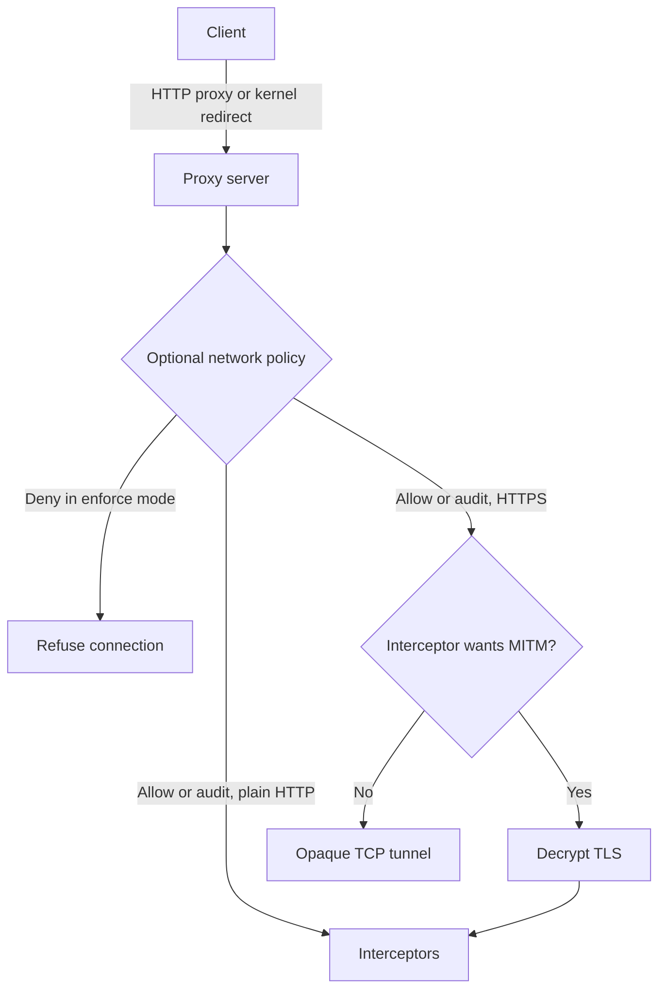

# PMG Proxy Library

A generic, extensible HTTP/HTTPS proxy server with man-in-the-middle (MITM) capabilities for intercepting and analyzing package manager traffic.
Built with [goproxy](https://github.com/elazarl/goproxy) library.

## Features

- Selective interception of HTTPS traffic
- Pluggable interceptors for different use cases
- Certificate generation and management for HTTPS interception (MITM)
- Optional destination policy with audit and enforce modes
- Explicit proxy clients and transparent, kernel-redirected clients

## Architecture



Set `NetworkPolicy` to assign destination rules.
Set `NetworkEnforce=true` to refuse a denied destination.
With `false`, the proxy records the decision and permits the connection.
`OnNetworkDecision` observes allowed and denied decisions, including destinations with no policy.
The check runs before interception.
It also checks a changed destination inside a decrypted tunnel.
See [network rules](sandbox.md#network-rules) for rule syntax.

`Transparent=true` accepts redirected TLS and origin-form HTTP.
The TLS path uses SNI to choose interception or an opaque splice.
It refuses TLS without a usable server name, including unsupported ECH traffic.
Origin-form HTTP must supply `Host`.
See [kernel enforcement](persistent-proxy.md#kernel-enforcement-linux) for deployment and original-destination recovery.

Interceptors run in no fixed order.
Each interceptor must have a unique `Name`.
HTTPS matching has two stages.
The tunnel decision receives method `CONNECT`, host, and port.
Its context has no request path or body and has empty headers.
An interceptor must match this context and request MITM before it can inspect encrypted request paths.
A path-only interceptor can still run if another interceptor requests MITM for the same host.
After decryption, matching runs once for each HTTP request.
`RequestContext.Body` remains unpopulated at that stage too.

An interceptor can implement `MITMDecider` and return `false` to observe an opaque tunnel.
The proxy calls its `HandleRequest` during this decision but discards the returned action.
That observer cannot block a tunnel through its return value.
Use the network policy for destination refusal before decryption.

| Action | Effect |
| --- | --- |
| `ActionAllow` or nil response | Continue to other interceptors and upstream. |
| `ActionBlock` | Stop immediately. The default status is 403. The proxy uses `BlockMessage` when it is not empty. Otherwise it uses the `BlockMessageRenderer` result. If that is empty, it uses a default message. |
| `ActionModifyRequest` | Replace headers when supplied. `ModifiedBody` has no effect. |
| `ActionModifyResponse` | Register one response modifier. Another interceptor can replace it. Modifiers do not form a chain. |

A `HandleRequest` error logs the failure and continues to other interceptors.
If none blocks, the request proceeds.
Return `ActionBlock` for a denial.
Returning an error does not deny the request.

The proxy reads the complete response body before it calls a modifier.
A body-read failure produces HTTP 503.
A modifier error restores the original body bytes and leaves the response status unchanged.
Header mutations made through the shared header map can remain after the error.
Do not use a modifier error as a security decision.

## Example

See [examples/proxy](../examples/proxy/README.md) for a logging interceptor.
Its bare CA export can replace client root sets.
Merge the CA with existing roots before setting replacement-style variables such as `SSL_CERT_FILE`, `PIP_CERT`, or `REQUESTS_CA_BUNDLE`.
Otherwise a client can reject a legitimate host that the proxy tunnels without interception.
`NODE_EXTRA_CA_CERTS` adds roots instead of replacing them.

Use `certmanager.MergeWithSystemCA(ca.Certificate)` to construct a merged bundle.
This helper works on a best-effort basis.
It can return only the PMG CA if it cannot load a system bundle.
Add required corporate roots explicitly in that case.
See [certificate trust](cert.md) and the CLI environment owner in [proxy_env.go](../packagemanager/proxy_env.go).

## Quick Start

This example starts an observation proxy for npm registry traffic.
It does not analyze or block packages.

```go
package main

import (
    "context"
    "log"
    "os"
    "os/signal"
    "time"

    "github.com/safedep/pmg/proxy"
    "github.com/safedep/pmg/proxy/certmanager"
)

type observer struct{}

func (observer) Name() string { return "npm-observer" }
func (observer) ShouldIntercept(ctx *proxy.RequestContext) bool {
    return ctx.Hostname == "registry.npmjs.org"
}
func (observer) HandleRequest(ctx *proxy.RequestContext) (*proxy.InterceptorResponse, error) {
    log.Printf("%s %s", ctx.Method, ctx.URL)
    return nil, nil
}

func main() {
    certConfig := certmanager.DefaultCertManagerConfig()
    ca, err := certmanager.GenerateCA(certConfig)
    if err != nil {
        log.Fatal(err)
    }
    if err := os.WriteFile("ca-cert.pem", ca.Certificate, 0o644); err != nil {
        log.Fatal(err)
    }
    manager, err := certmanager.NewCertificateManagerWithCA(ca, certConfig)
    if err != nil {
        log.Fatal(err)
    }
    cfg := proxy.DefaultProxyConfig()
    cfg.ListenAddr = "127.0.0.1:8888"
    cfg.CertManager = manager
    cfg.Interceptors = []proxy.Interceptor{observer{}}
    server, err := proxy.NewProxyServer(cfg)
    if err != nil {
        log.Fatal(err)
    }
    if err := server.Start(); err != nil {
        log.Fatal(err)
    }
    log.Printf("proxy at %s", server.Address())
    signals := make(chan os.Signal, 1)
    signal.Notify(signals, os.Interrupt)
    <-signals
    ctx, cancel := context.WithTimeout(context.Background(), 10*time.Second)
    defer cancel()
    if err := server.Stop(ctx); err != nil {
        log.Print(err)
    }
}
```

The program writes its CA certificate to `ca-cert.pem` in its working directory.
Run npm in the directory of the proxy process.
Set `HTTPS_PROXY=http://127.0.0.1:8888` and `NODE_EXTRA_CA_CERTS="$PWD/ca-cert.pem"`.

`DefaultProxyConfig` enables MITM, so supply a certificate manager.
The constructor does not fill individual omitted timeout fields in a supplied config.
Defaults include a 30-second connect and TLS-handshake timeout, a 5-minute response-header timeout, 30-minute server read/write deadlines, and 2 upstream retries.
Zero connect or request timeout disables that configured deadline.
Zero retries disables retries.
Zero server read/write timeout uses 30 minutes.

The upstream transport honors `HTTP_PROXY`, `HTTPS_PROXY`, and `NO_PROXY`.
CONNECT dialing supports HTTP, HTTPS, and SOCKS5 upstream proxies.
Loopback destinations bypass the upstream proxy.
With the default dialer, the proxy refuses to dial its own listeners.
A custom `UpstreamDialContext` replaces that dialer and its check.
Retries apply only to GET, HEAD, or OPTIONS requests without a body while the request context is live.
Retries remain subject to the transport timeouts.
TLS connections that the proxy establishes use TLS 1.2 or later and verify system roots by default.
`UpstreamTLSClientConfig` can override those settings.
For an opaque tunnel, the client validates the destination certificate.

`Start` binds synchronously, starts serving goroutines, and returns.
`Address` reports the bound address, including an assigned ephemeral port.
Registration uses locks and affects subsequent handler calls and new tunnel decisions.
It cannot decrypt an existing opaque tunnel.
`Stop` delegates to `http.Server.Shutdown`.
That API does not close hijacked CONNECT sessions.
Transparent TLS sessions served by the HTTP server follow its shutdown path.
Opaque tunnels and splices have no proxy-imposed time limit.

The [built-in interceptor package](../proxy/interceptors/factory.go) constructs registry handlers for the ecosystems its caller supplies and appends audit logging.
`RegistryCatalog` adds configured registry endpoints.
See the [package-manager checklist](package-manager.md) when extending registry analysis.

## Certificate Manager

The `certmanager` package provides certificate generation and caching.
It also saves and loads signing CAs, merges trust bundles, and reports status through `InspectCA`.
The default CA lifetime is 365 days.
Host certificates last 1 day and use an in-memory cache.
The default RSA key size is 2048 bits.
Validation rejects smaller keys.
PEM-only imports support PKCS#1 RSA keys.
Callers can instead provide parsed `X509Cert` and RSA `PrivKey` fields.

### Usage

Save both the certificate and private key when you need to restore the signing CA.
A public certificate export alone is not CA persistence.

```go
ca, err := certmanager.LoadUsableCA(dir)
if errors.Is(err, os.ErrNotExist) {
    ca, err = certmanager.GenerateCA(certmanager.PersistentCACertManagerConfig())
    if err == nil {
        err = certmanager.SaveCA(dir, ca)
    }
}
if err != nil {
    return err
}
manager, err := certmanager.NewCertificateManagerWithCA(ca, certmanager.DefaultCertManagerConfig())
if err != nil {
    return err
}
hostCert, err := manager.GenerateCertForHost("registry.npmjs.org")
```

This fragment needs `errors`, `os`, a `dir` path, and normal handling of the final result.
`PersistentCACertManagerConfig` gives the CA a 3650-day lifetime.
`LoadUsableCA` rejects a CA that expires within 1 hour.
Handle expiry and corruption through a deliberate rotation process.
`SaveCA` writes the public certificate with mode 0644 and creates the key with mode 0600.
Keep the private key secret.
See [rotation](cert.md#rotation-and-expiry) before replacing a trusted CA.
