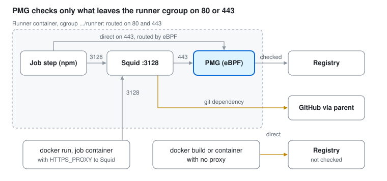

# Validate PMG on ARC runners behind a local Squid

This SOP checks which install paths PMG covers on a self-hosted GitHub Actions runner that Actions
Runner Controller (ARC) runs on Kubernetes. The runner container runs PMG with kernel enforcement
(`pmg-entrypoint.sh`), dockerd, and a local Squid. Jobs reach Squid through
`HTTPS_PROXY=http://172.17.0.1:3128`.

The operator runs one test workflow on one new runner Pod and compares each result with the table in
[Expected results](#expected-results).

## How coverage works

PMG checks a package download only when the connection leaves the Pod on port 80 or 443 from a
process inside the cgroup that PMG enforces on (`.../runner`), in the Pod's network namespace.

- PMG does not route port 3128. It routes Squid's own connection to the registry on 443, when Squid
  runs inside `.../runner`.
- A job step that skips Squid connects to 443 directly. PMG routes that connection too.
- dockerd starts containers in other cgroups and network namespaces. PMG covers a container or a
  build only when it uses Squid.
- Squid sends GitHub to a parent pool. PMG does not see that traffic.



## Files

| File | Purpose |
| --- | --- |
| [`pmg-sop.yml`](pmg-sop.yml) | The test workflow. Copy it to `.github/workflows/pmg-sop.yml` in a test repository |
| [`case.sh`](case.sh) | Runs one case and prints one verdict line. Copy it to `.github/pmg-sop/case.sh` |
| [`cgroup-check.sh`](cgroup-check.sh) | Reports whether Squid is inside the cgroup that PMG enforces on |

## Prerequisites

- [ ] A test runner pool with `replicas: 1` and its own label. All jobs then run on one Pod and one
      PMG daemon.
- [ ] A new Pod. Do not restart Squid or PMG by hand after the Pod starts.
- [ ] Squid starts as a child of the command that `pmg-entrypoint.sh` runs. It does not start from a
      lifecycle hook, a probe, cron or `kubectl exec`.
- [ ] If the Squid parent pool listens on port 80 or 443, its addresses are in
      `proxy.server.enforce.skip_destinations`.
- [ ] A test repository with `pmg-sop.yml` and `case.sh`. Replace `<runner-label>` and `<org>`.
- [ ] A git dependency repository `<org>/pmg-gitdep-test` with this `package.json`:

  ```json
  {"name": "pmg-gitdep-test", "version": "1.0.0", "dependencies": {"safedep-test-pkg": "*"}}
  ```

`safedep-test-pkg` is a harmless SafeDep test package that PMG blocks as malware.

## Step 1: check the Pod

Run these commands in the runner container with `kubectl exec`. Use `kubectl exec` only to read.
PMG does not route a process that `kubectl exec` starts, so run every install from the workflow.
In a container that runs as root, drop `sudo`.

1. PMG started with kernel enforcement. Expect `[pmg] attach to .../runner` and
   `daemon started ... with kernel enforcement`.

   ```bash
   kubectl logs <pod> | grep -E '^\[pmg\]|daemon started'
   ```

2. Squid is inside the enforced cgroup. Expect `ROUTED` on every line. `NOT ROUTED` stops the test.

   ```bash
   kubectl cp cgroup-check.sh <pod>:/tmp/cgroup-check.sh
   kubectl exec <pod> -- bash /tmp/cgroup-check.sh
   ```

3. PMG decrypts Squid's registry traffic. Expect `issuer: O=SafeDep PMG; CN=SafeDep PMG Proxy CA`.

   ```bash
   curl -sv -x http://172.17.0.1:3128 https://registry.npmjs.org/ -o /dev/null 2>&1 | grep -i issuer
   ```

4. PMG runs with the expected settings. Expect `Kernel enforcement: active (cgroup .../runner, ports 80,443, ...)`
   and `namespaces: ignore`.

   ```bash
   sudo pmg proxy status --state /run/pmg/proxy-state.json
   ```

5. Record the PMG block count.

   ```bash
   sudo sh -c 'cat /root/.config/safedep/pmg/logs/*-pmg.log' | grep -c '"event_type":"malware_blocked"'
   ```

## Step 2: run the workflow

Start `pmg-sop` with **Run workflow**. Each case prints one line, for example:

```text
T1a BLOCKED rc=1 pmg_blocks=+1 at 17:52:36
```

A case counts as blocked by PMG only when `pmg_blocks` rises. Squid also answers 403 when its ACL
refuses a client. In T5 and T6, read the block count with Step 1, check 5.

After the run, repeat Step 1, checks 2 and 5.

## Expected results

| ID | Install path | Expected |
| --- | --- | --- |
| T1a | Job step, npm through Squid | Blocked |
| T1b | Job step, npm with no proxy variables | Blocked |
| T1c | Job step, `curl` of the test tarball through Squid | 403 |
| T2a | `docker run` through Squid | Blocked when the container trusts the PMG CA. TLS error when it does not |
| T2b | `docker run` with no proxy variables | Installed (not covered) |
| T3a | `docker build` with no proxy build-arg | Installed (not covered) |
| T3b | `docker build` through Squid, PMG CA in the image | Blocked |
| T4a | Git dependency | The git source installs unchecked. Its registry dependency is blocked |
| T5 | Job container (`container:`) | Blocked with `HTTPS_PROXY` and the CA. Installed with no proxy |
| T6 | Container action (`uses: docker://`) | Same as T5 |

## Step 3: when a result does not match

Find the case's request in the Squid log (the last step of the `host` job):

| Squid log line | Meaning |
| --- | --- |
| `TCP_TUNNEL/200 ... HIER_DIRECT/<ip>` | Squid dialled the registry. PMG must see it |
| `... PARENT/<peer>` | Squid sent it to the parent pool |
| `TCP_DENIED/403` | Squid's ACL refused the client. The 403 is not from PMG |
| No line | The tool did not use Squid |

| Result | Cause | Action |
| --- | --- | --- |
| T1a installs, `HIER_DIRECT` | Squid is outside `.../runner` | Fix how Squid starts. Use a new Pod |
| T1a installs, T1c gives 200 | PMG decrypts but does not block. Most often a failed analysis | Go to Step 4 |
| T1a installs, T1c gives 403 | npm uses another registry, proxy or `noproxy` (see T0) | Fix the npm config |
| T1b installs | The step runs outside `.../runner` (see T0) | Collect T0 output and `kubectl logs` |
| `E403`, `pmg_blocks=+0` | Squid's ACL refused the client | Allow the client address in Squid |
| `TLS-ERROR` in a container or build | PMG decrypted it, the container does not trust the PMG CA | Add the CA |
| Results change between runs | PMG allows packages for 30 seconds after 3 failed analysis calls | Go to Step 4 |

## Step 4: see what PMG decides

Without `--debug`, the daemon does not log analysis errors. These commands replace it with a debug
daemon. Run them with `kubectl exec`.

1. Stop the entrypoint's supervisor, then stop PMG.

   ```bash
   cg=$(sudo sed -n 's/.*"cgroup_path": *"\([^"]*\)".*/\1/p' /run/pmg/proxy-state.json | head -1)
   sudo touch /run/pmg/stopping; sleep 3
   sudo pmg proxy stop --state /run/pmg/proxy-state.json
   ```

2. Start PMG with `--debug` on the same cgroup.

   ```bash
   sudo setsid nohup env -u HTTPS_PROXY -u HTTP_PROXY -u https_proxy -u http_proxy \
     pmg --debug proxy start --enforce --enforce-cgroup "$cg" --state /run/pmg/proxy-state.json \
     > /tmp/pmg-debug.log 2>&1 < /dev/null &
   sleep 5; sudo pmg proxy status --state /run/pmg/proxy-state.json
   ```

3. Run the workflow again, then read the decisions.

   ```bash
   grep -aE 'Analyzing package|Analysis complete|Failed to analyze|Circuit breaker|Blocking|No registry config|unresolved' /tmp/pmg-debug.log
   ```

| Debug log | Meaning |
| --- | --- |
| `Analyzing package`, then `Blocking malicious package` | PMG works. The request path differs. Go to Step 3 |
| `Failed to analyze package` | PMG cannot reach the analysis service and allows the package |
| `circuit breaker is open` | PMG allows packages for 30 seconds without analysis |
| No line for the package | The request did not reach PMG's registry check |

Delete the Pod after this step.

## Known gaps

| Gap | Cases | Options |
| --- | --- | --- |
| A build or container that does not use Squid | T2b, T3a, T5, T6 | A `proxies` block in the runner user's `~/.docker/config.json`, or PMG's nftables redirect for containers. Both need the PMG CA in the container |
| Git dependencies | T4a | PMG checks registry downloads only. Refuse `github:` and `git+` specs in a lockfile check, or deny the GitHub fetch in Squid |
| Squid outside `.../runner` | Step 1, check 2 | Start Squid from the entrypoint's command |
| PMG allows a package when analysis fails | Step 4 | Watch the debug log during validation |

## Cleanup

- [ ] Delete the test Pod.
- [ ] Remove `safedep-test-pkg` from any lockfile that the test changed.
