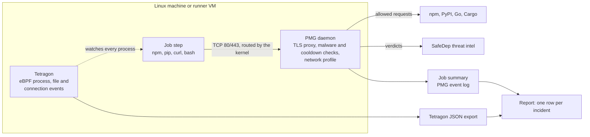

# PMG + Tetragon user guide

PMG and Tetragon together protect a Linux machine that installs open source packages: a CI runner,
a build server, a developer laptop or a VM for a coding agent. PMG decides on each package request.
Tetragon watches each process. This guide shows the work of two people:

- The **DevOps engineer** deploys the two agents and keeps the builds green.
- The **security engineer** reads what the agents found, sets the policy and handles incidents.

> Status: the GitHub Actions setup in [Part 1](#part-1-deploy-on-github-actions-cloud-runners) is
> what the POC workflow in this directory runs. [Part 2](#part-2-deploy-on-other-linux-machines) and
> [Part 3](#part-3-deploy-on-kubernetes-with-helm) are designs. The POC did not test them.

## Contents

- [What the solution does](#what-the-solution-does)
- [How it works](#how-it-works)
- [Part 1: deploy on GitHub Actions cloud runners](#part-1-deploy-on-github-actions-cloud-runners)
- [Part 2: deploy on other Linux machines](#part-2-deploy-on-other-linux-machines)
- [Part 3: deploy on Kubernetes with Helm](#part-3-deploy-on-kubernetes-with-helm)
- [Part 4: operate the solution as a security engineer](#part-4-operate-the-solution-as-a-security-engineer)
- [Limits](#limits)
- [Reference](#reference)

## What the solution does

| Threat | PMG | Tetragon | Result |
| --- | --- | --- | --- |
| Known malicious package | Blocks the download | Records the process tree that asked for it | Block, with the step that pulled it |
| Package version younger than the cooldown | Hides it from metadata or refuses it | Records the tool that asked for it | Block, with an owner |
| Malicious install script that arrives from a cache or an image | Refuses HTTPS to hosts outside the network profile | Reports or kills connections on other ports, and reports credential file reads | The exfiltration stops, and you see the script |
| Secret theft from `Runner.Worker` memory | Refuses the upload to an unknown host | Reports or kills the read of `/proc/<pid>/mem` | Detection and response |
| Reverse shell | Cannot see it | Reports or kills `bash` with `/dev/tcp` | Response that PMG alone does not have |
| Tampering with PMG | The post step fails the job when the daemon is gone | Reports signals to PMG and BPF program loads | Evidence that does not depend on PMG |
| A client that ignores proxy variables | The kernel routes TCP 80 and 443 through PMG | Records the client | No bypass on those ports |

PMG reads the package name and version inside TLS, so it can block one package and allow the next.
Tetragon sees processes, files and connections in the kernel, but not inside TLS. Each tool covers
what the other cannot see.

## How it works



- **PMG** attaches BPF programs to a cgroup. The kernel sends every TCP connection on ports 80 and 443
  to the PMG proxy. A process cannot skip this with `env -i`, `sudo` or its own HTTP client. PMG
  decrypts registry traffic with its own CA and asks SafeDep threat intel for a verdict on each package.
- **Tetragon** loads eBPF programs that report each process start and exit. TracingPolicies add hooks
  on connections, file opens, signals and BPF loads. A policy can report a match or kill the process.
- **The report** joins the two outputs. PMG records the PID of each client. Tetragon records the
  parent chain of each PID. Together they show which step started the process that made the request.
  In the POC, `scripts/report.py` does this join. It is not a product feature yet.

## Part 1: deploy on GitHub Actions cloud runners

Audience: DevOps engineer. Target: GitHub-hosted Ubuntu runners, standard or larger, x64.

### Requirements

| Requirement | GitHub-hosted Ubuntu | Why |
| --- | --- | --- |
| Linux kernel 5.15 or later with BTF | Yes | PMG kernel routing and Tetragon both need BTF |
| Kernel kprobes | Yes | Tetragon's base sensor needs them |
| Passwordless `sudo` | Yes | Both agents run as root |
| Job runs on the VM, not in `container:` | Your choice | Neither agent can attach from inside a job container |
| `timeout-minutes` on the job | Your choice | A hung proxy blocks the runner until the timeout |

macOS, Windows and `ubuntu-slim` runners cannot run either agent with kernel enforcement.

### Step 1: start Tetragon

Add a step before any step that installs packages. The POC uses
[`scripts/start-tetragon.sh`](scripts/start-tetragon.sh). The script:

1. Downloads the Tetragon release tarball and checks its SHA-256 sum.
2. Copies the TracingPolicies of one mode into `/etc/tetragon/tetragon.tp.d/`.
3. Installs Tetragon as a systemd service, with JSON export to `/var/log/tetragon/tetragon.log`.
4. Waits until every policy is enabled, and prints the seconds it took.

```yaml
- name: Start Tetragon
  run: poc/pmg-tetragon/scripts/start-tetragon.sh audit   # or: enforce
```

Start with `audit`. Move to `enforce` after a week of clean runs (see
[Roll out enforcement](#roll-out-enforcement)).

### Step 2: start PMG

Put PMG right after Tetragon, so Tetragon sees the PMG start too.

```yaml
- name: Start PMG
  uses: safedep/pmg@v2            # pin to a commit SHA
  with:
    enforce: "true"
    network-profile: .pmg/network.yml
    network-mode: audit           # then: enforce
```

- `enforce: "true"` routes every eligible TCP connection on ports 80 and 443 through PMG in the
  kernel. The step fails when the runner cannot enforce.
- `network-profile` names the hosts the job may reach. A path that does not exist yet starts PMG with
  no profile, and the job summary proposes one.
- The post step stops PMG, writes the job summary and fails the job when PMG blocked a package. The POC
  sets `fail-on-violation: "false"` so that its own report decides.

Malware blocking and the 2-day cooldown are on by default. They block in every mode.

### Step 3: build the network profile

1. Run the job with no profile. The job summary proposes `.pmg/network.yml` from the hosts the job
   reached.
2. Review each rule and commit the file. Add a `CODEOWNERS` line for it, because it is as trusted as
   the workflow.
3. Run in `audit` for a few days. The summary lists each host the profile does not allow.
4. Set `network-mode: enforce`. PMG then refuses each host outside the profile.

The POC profile is [`pmg/network.yml`](pmg/network.yml). It allows only the npm and PyPI registries
on top of the built-in `github-actions` profile.

### Step 4: roll out Tetragon policies

The POC ships two sets of the same four policies:

| Policy | Hook | Audit set | Enforce set |
| --- | --- | --- | --- |
| [`ci-egress`](tetragon/audit/ci-egress.yaml) | `tcp_connect` to a port other than 80 and 443, outside private ranges | Report | Kill `curl`, `wget` and `nc` |
| [`reverse-shell`](tetragon/audit/reverse-shell.yaml) | `tcp_connect` by `bash`, `sh`, `dash` or `nc` to a non-loopback address | Report | Kill |
| [`runner-secrets`](tetragon/audit/runner-secrets.yaml) | Open of `/proc/<pid>/mem`, credential files, `ptrace` | Report | Kill on `/proc/<pid>/mem`, report the rest |
| [`pmg-tamper`](tetragon/audit/pmg-tamper.yaml) | `kill` with `SIGKILL`, `SIGTERM` or `SIGSTOP`, and BPF program loads | Report | Report |

Tetragon matches a binary by its resolved path. A tool from a toolcache path (for example Node.js from
`actions/setup-node`) needs its own path in `matchBinaries`.

### Roll out enforcement

1. Run every job with the audit set and `network-mode: audit` for one to two weeks.
2. Read the reports (see [Part 4](#part-4-operate-the-solution-as-a-security-engineer)). Each match
   is an attack or a rule to change.
3. Turn on `network-mode: enforce` for the jobs that publish or deploy first. They hold the secrets
   that matter most.
4. Switch those jobs to the enforce set of Tetragon policies.
5. Repeat for the other jobs.

### Cost per job

The POC measures the start-up time of each agent in each run. See the `Start-up cost` line of the
report in the job summary and in [`README.md`](README.md#results).

### Troubleshoot

| Symptom | Cause | Fix |
| --- | --- | --- |
| `Start PMG` fails with "cannot enforce" | The job runs in a container, or the runner has no `sudo` | Run the job on the VM. Use `enforce: auto` to fall back to proxy variables |
| Registry TLS errors after PMG starts | A tool does not trust the system CA store | Set `NODE_EXTRA_CA_CERTS`, `REQUESTS_CA_BUNDLE` or `PIP_CERT` to `$PMG_CA_BUNDLE` |
| A job hangs until `timeout-minutes` | The PMG daemon hung. The runner's own traffic to GitHub goes through it | Check `sudo cat /root/.cache/safedep/pmg/proxy.log` in a later step with `if: always()` |
| Tetragon policy shows `error` state | A hook does not exist in this kernel | Run `sudo tetra tracingpolicy list` and read the error. Remove that hook or add `ignore: callNotFound: true` |
| A legitimate tool is killed | An enforce policy matched it | Add the tool's path to `NotIn` in that policy, or move the policy back to audit |

## Part 2: deploy on other Linux machines

Audience: DevOps engineer. Targets: self-hosted runner VMs, build servers, Jenkins agents, CircleCI
machine executors, Harness VM runners, Buildkite agents, Linux laptops. This part is a design. The POC
did not test it.

The same two agents run as systemd services. Bake them into the machine image (AMI, Packer, golden
image) so they run before the first job.

### Install PMG as a service

```bash
sudo pmg setup cert install --system        # PMG CA into the system trust store
sudo cp examples/systemd/pmg-proxy.service /etc/systemd/system/
sudo systemctl enable --now pmg-proxy
sudo pmg proxy env --state /run/pmg/proxy-state.json   # trust variables for clients
```

- The unit runs `pmg proxy start --enforce`. The kernel routes every eligible process on the host.
- Put the variables that `pmg proxy env` prints where your CI agent reads its environment: the
  runner's `.env` file, the Jenkins agent environment, the CircleCI machine image profile.
- Docker jobs on the host need `--enforce-namespaces redirect`, and each container must trust the PMG
  CA. See [`docs/persistent-proxy.md`](../../docs/persistent-proxy.md).

### Install Tetragon as a service

```bash
curl -LO https://github.com/cilium/tetragon/releases/download/v1.8.0/tetragon-v1.8.0-amd64.tar.gz
tar -xzf tetragon-v1.8.0-amd64.tar.gz
sudo install -d /etc/tetragon/tetragon.tp.d
sudo cp poc/pmg-tetragon/tetragon/audit/*.yaml /etc/tetragon/tetragon.tp.d/
sudo ./tetragon-v1.8.0-amd64/install.sh
```

### What changes from GitHub-hosted runners

| Topic | GitHub-hosted | Long-lived machine |
| --- | --- | --- |
| Lifetime | One VM per job | Many jobs on one machine. One PMG daemon serves all of them |
| Job verdict | PMG post step per job | No post step. Use a runner job hook, or read the event log centrally |
| Job identity | `GITHUB_*` variables of the job | Runner job hooks (`ACTIONS_RUNNER_HOOK_JOB_STARTED`), or the CI system's job ID |
| State between jobs | None | The CA, the daemon and caches stay. Prefer ephemeral VMs |
| Kernel | Ubuntu on Azure, kprobes on | Check BTF and kprobes on your image: `ls /sys/kernel/btf/vmlinux` and `grep KPROBES /boot/config-$(uname -r)` |

### Laptops

PMG can run per command (`pmg npm install`) or as a system daemon. Tetragon runs on a Linux laptop with
a standard distribution kernel. On macOS and Windows, use PMG without Tetragon.

## Part 3: deploy on Kubernetes with Helm

Audience: DevOps engineer. Target: GitHub Actions Runner Controller (ARC) runner scale sets, and any CI
that runs jobs in pods. This part is a design. The POC did not test it.

### Today: Tetragon as a DaemonSet, PMG in the runner image

```bash
helm repo add cilium https://helm.cilium.io
helm install tetragon cilium/tetragon -n kube-system -f tetragon-values.yaml
kubectl apply -f tracing-policies/          # TracingPolicy or TracingPolicyNamespaced objects
```

```yaml
# tetragon-values.yaml
tetragon:
  clusterName: ci-prod
  exportFilename: tetragon.log
  processAncestors:
    enabled: "base,kprobe"
rthooks:
  enabled: true          # attaches policies and pod metadata before the container starts
  interface: nri-hook    # containerd 2.0; use oci-hooks on CRI-O
```

For Kubernetes, wrap each POC policy in a `TracingPolicyNamespaced` for the runner namespace, or add a
`podSelector` on the ARC runner label:

```yaml
spec:
  podSelector:
    matchLabels:
      app.kubernetes.io/component: runner
```

PMG runs in the runner image today. The image copies `/opt/safedep/pmg` from `ghcr.io/safedep/pmg`
and starts the runner through `pmg-entrypoint.sh`:

```dockerfile
FROM ghcr.io/actions/actions-runner:latest
COPY --from=ghcr.io/safedep/pmg:latest /opt/safedep/pmg /opt/safedep/pmg
ENTRYPOINT ["/opt/safedep/pmg/bin/pmg-entrypoint.sh", "/home/runner/run.sh"]
```

```yaml
# ARC gha-runner-scale-set values
template:
  spec:
    containers:
      - name: runner
        image: registry.example.com/ci/runner-pmg:1.0
        securityContext:
          privileged: true     # PMG attaches BPF programs to the runner cgroup
        env:
          - name: KUBE_POD_NAME
            valueFrom: { fieldRef: { fieldPath: metadata.name } }
          - name: KUBE_NAMESPACE
            valueFrom: { fieldRef: { fieldPath: metadata.namespace } }
        volumeMounts:
          - name: pmg-secret            # optional: SafeDep Cloud keys
            mountPath: /etc/pmg-secret
            readOnly: true
    volumes:
      - name: pmg-secret
        secret: { secretName: pmg-safedep-cloud }
```

Limits of this setup:

- Root inside the runner container can stop PMG. Harden the pod: no `sudo`, drop `NET_RAW`,
  `seccompProfile: RuntimeDefault`.
- PMG events carry the pod, but not the GitHub repo, run or job.
- Privileged Docker-in-Docker gives a job root on the node. No node agent is a boundary there.

### Planned: `pmg-node` DaemonSet

The design in the [PMG + Tetragon design doc](https://claude.ai/artifact/PC85BukPcfGYYPWvFYUUSF) moves
PMG out of the runner image into a node DaemonSet. The Helm values below show the intended operator
experience. The chart does not exist yet.

```yaml
# pmg-node values (planned)
nodeSelector:
  ci.safedep.io/runner-node: "true"
selector:
  # Pods that pmg-node attaches to.
  matchLabels:
    app.kubernetes.io/component: runner
identity:
  arcEphemeralRunners: true       # read job identity from EphemeralRunner status
  githubApp:
    secretName: pmg-github-app    # optional: run attempt and numeric job id
policy:
  networkProfile:
    configMap: pmg-network-profiles
    mode: audit
  cooldownDays: 2
tetragon:
  exportPath: /var/run/cilium/tetragon/tetragon.log   # read-only hostPath
failClosed: true                  # pinned BPF links refuse connections if pmg-node dies
```

What the DevOps engineer gets with `pmg-node`:

- No runner image change and no privileged runner container.
- Each event carries the repo, workflow, run, attempt and job from the EphemeralRunner.
- A post-job hook writes the verdict into the GitHub run summary.

## Part 4: operate the solution as a security engineer

Audience: security engineer.

### Where to look

| Output | Where | What it holds |
| --- | --- | --- |
| PMG job summary | GitHub run page, the job's summary | Verdict, blocked packages, each denied connection with its program, the hosts the job reached, a proposed network profile |
| POC report | The same summary, above the PMG section | One row per scenario: result, what PMG saw, what Tetragon saw, the process chain |
| PMG event log | Artifact `pmg-events.jsonl` | One JSON line per event: `malware_blocked`, `dependency_cooldown`, `network_policy`, `proxy_host_observed` with `client_pid`, `client_comm`, `client_exe` |
| Tetragon export | Artifact `tetragon.jsonl` | `process_exec`, `process_exit`, `process_kprobe` with `policy_name`, `function_name`, `args`, `action`, and the process and parent |
| SafeDep Cloud (optional) | SafeDep dashboard | PMG events per endpoint, when the job sets `api-key` or OIDC `tenant-id` |

### Read an incident

Example: the POC test T4. An install script reads `.npmrc` and sends data out.

1. The PMG summary shows a denied connection to `example.com:443`, with the program `curl`.
2. The report row shows `ci-egress: tcp_connect 192.0.2.10:8080 (killed)`.
3. The process chain shows `curl ← dash ./postinstall.sh ← node npm install ← bash`. The install script
   of a package started the connection.
4. The Tetragon export holds a `runner-secrets` event for the `.npmrc` read by the same script.
5. Response: find the package in the lockfile, remove it, rotate the npm token, and check the cache
   that delivered it.

### Policy levers

| Lever | Tool | Where | Effect |
| --- | --- | --- | --- |
| Cooldown days | PMG | `cooldown-days` input, or `dependency_cooldown.days` in the config file | Holds back versions younger than N days |
| Paranoid mode | PMG | `paranoid: "true"` | Blocks packages that the analysis only suspects |
| Trusted packages | PMG | `trusted_packages` in the config file | Skips checks for named packages, with a reason |
| Network profile | PMG | `.pmg/network.yml`, `network-mode` | Allows only named hosts on ports 80 and 443 |
| Cloud policy | PMG | SafeDep Cloud | One block list and cooldown for the whole tenant |
| Egress backstop | Tetragon | `ci-egress` policy | Reports or kills connections on other ports |
| Runtime detections | Tetragon | `runner-secrets`, `reverse-shell`, `pmg-tamper` | Reports or kills secret reads, reverse shells, tampering |
| Report or kill | Tetragon | `matchActions` in each policy | No action reports. `Sigkill` kills the process |

### What to alert on

- Any `malware_blocked` event. A malicious package is in a dependency tree.
- Any `runner-secrets` event on `/proc/<pid>/mem`. Legitimate jobs do not read another process's memory.
- Any `reverse-shell` event.
- A `pmg-tamper` signal that targets the PMG PID, or a BPF load by a binary other than `pmg` and
  `tetragon`.
- A new host in `network_policy` audit events. It is either a new dependency source or an exfiltration.

### Manage exceptions

- A package that must install: add it to `trusted_packages` with a reason, reviewed by security.
- A host that a job needs: add it to the network profile in a pull request. `CODEOWNERS` routes it to
  security.
- A tool that a Tetragon policy kills: add its path to a `NotIn` list in that policy, or keep the policy
  in audit for that workflow.

## Limits

- PMG routes TCP 80 and 443 and registry ports only. Tetragon covers other ports by IP, not by host
  name.
- Neither tool sees DNS tunnelling.
- Neither tool sees a package that comes from a cache with no download. Tetragon sees what its install
  script does.
- A job with root and the `CAP_SYS_ADMIN` capability can detach BPF programs. Hardening and the
  `pmg-tamper` policy reduce this risk. They do not remove it.
- Tetragon open source cannot refuse a connect without `CONFIG_BPF_KPROBE_OVERRIDE`. The POC uses
  `Sigkill`.
- The join of PMG and Tetragon events is a POC script, not a product feature.

## Reference

| Path | What it is |
| --- | --- |
| [`README.md`](README.md) | The POC: scenarios, how to run it, results |
| [`../../.github/workflows/poc-pmg-tetragon.yml`](../../.github/workflows/poc-pmg-tetragon.yml) | The POC workflow: `unprotected`, `audit` and `enforce` jobs |
| [`pmg/network.yml`](pmg/network.yml) | PMG network profile |
| [`tetragon/audit/`](tetragon/audit/), [`tetragon/enforce/`](tetragon/enforce/) | Tetragon TracingPolicies |
| [`scripts/start-tetragon.sh`](scripts/start-tetragon.sh) | Installs Tetragon and loads one policy set |
| [`scripts/scenarios.sh`](scripts/scenarios.sh) | The eight attack scenarios |
| [`scripts/collect.sh`](scripts/collect.sh) | Copies the PMG and Tetragon outputs |
| [`scripts/report.py`](scripts/report.py) | Joins the outputs and checks each scenario |
| [`fixtures/evil-postinstall/`](fixtures/evil-postinstall/) | A harmless stand-in for a malicious install script |
